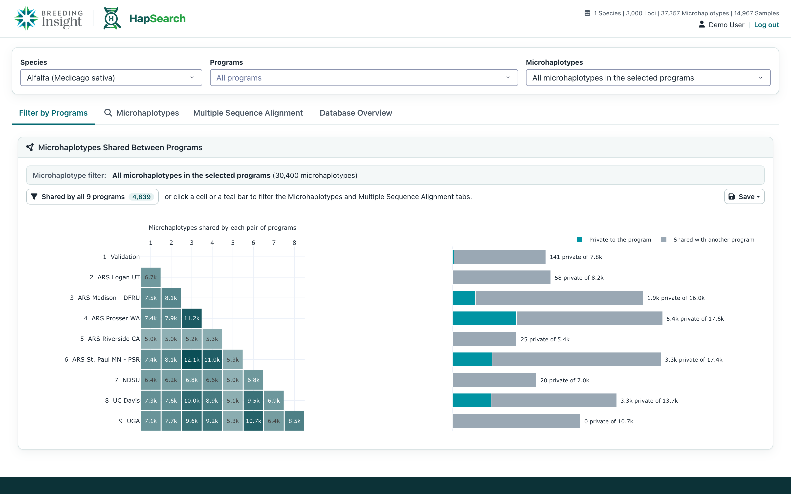
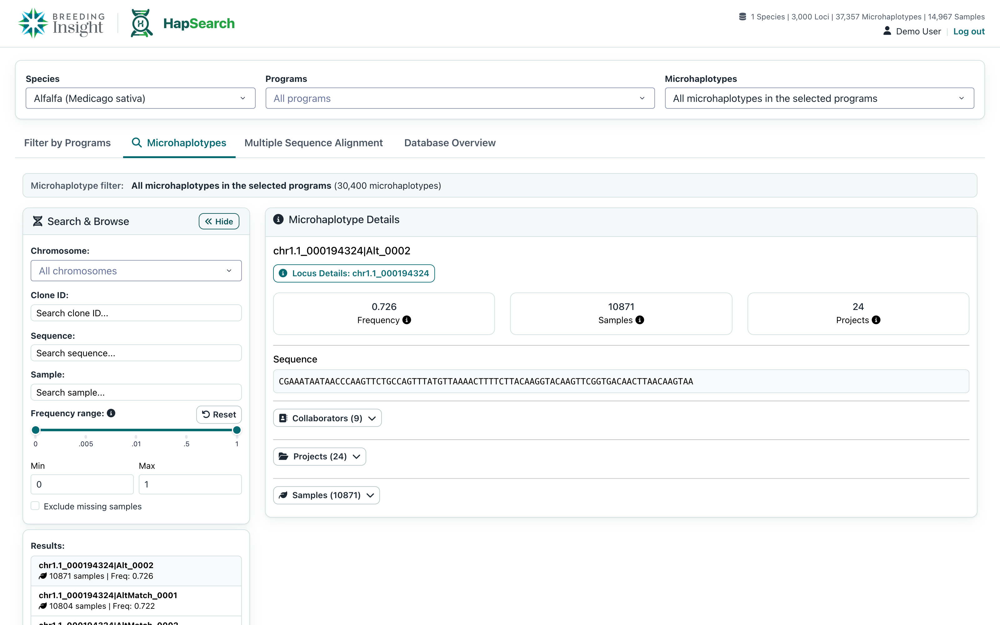
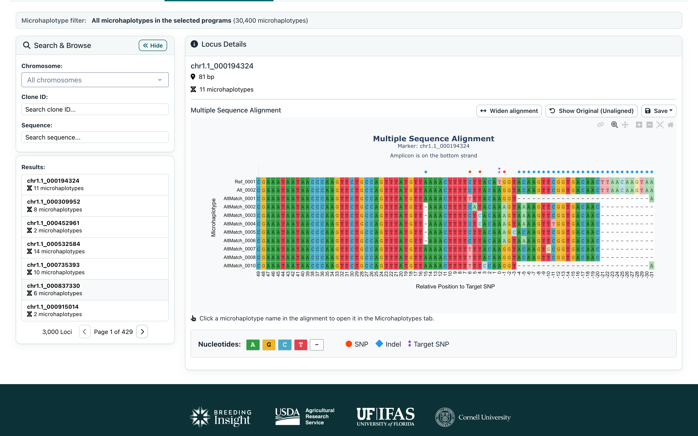
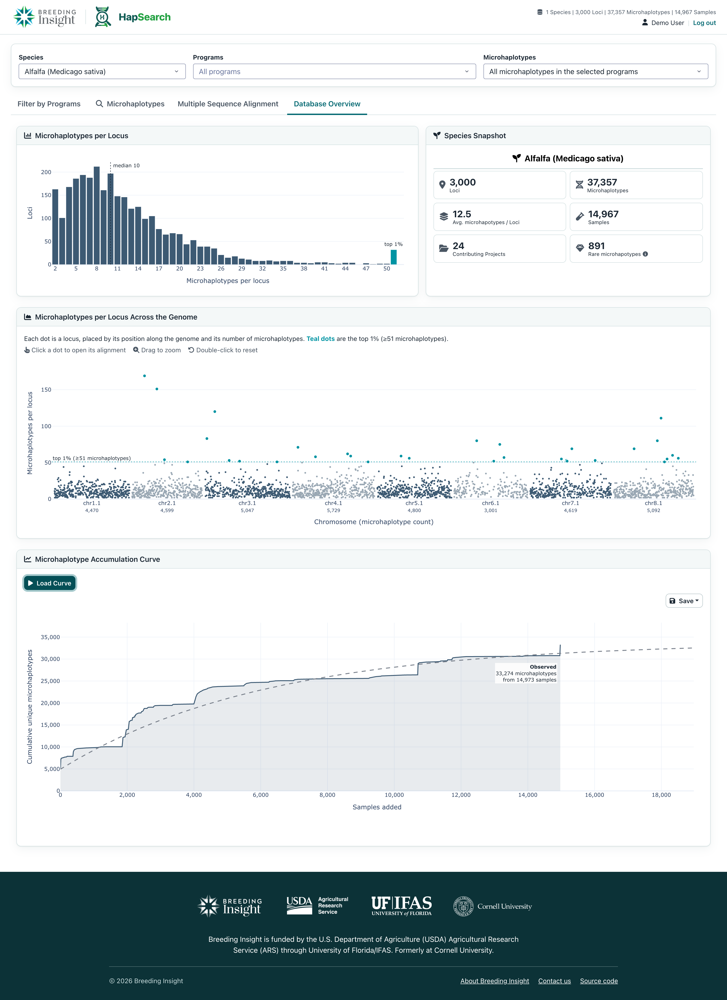

<!-- badges: start -->

<!-- badges: end -->

HapSearch is a web-based exploration platform for microhaplotype data in specialty crop breeding, hosted by [Breeding Insight](https://breedinginsight.org/) at **[hapsearch.breedinginsight.org](https://hapsearch.breedinginsight.org/)**. It brings marker sequences, variants, samples, projects, and collaborator information into one searchable interface, so breeders and researchers can find the microhaplotypes, samples, and collaborators relevant to their work without digging through spreadsheets, local databases, and analysis scripts.

Microhaplotypes are short genomic regions containing multiple nearby variants observed together. Their allelic diversity and local phase information make them useful for characterizing germplasm, tracking trait-associated variation, and designing crosses.

## Key Features

- **Web-Based Interface:** Explore microhaplotype data in your browser. No command line or local database needed.
- **Filter by Programs:**
    - Compare which microhaplotypes each breeding program holds.
    - See which microhaplotypes are private to a program and which are shared between programs.
    - Narrow every other tab to the microhaplotypes a set of programs shares.
- **Microhaplotypes:**
    - Search by Clone ID, chromosome, sequence, or sample.
    - Filter by allele frequency.
    - See the samples, projects, and collaborators behind each microhaplotype, and save the sample list as CSV.
- **Multiple Sequence Alignment:**
    - View every microhaplotype at a locus aligned to its reference, exactly as [BIGr](https://github.com/Breeding-Insight/BIGr) and [BIGapp](https://github.com/Breeding-Insight/BIGapp) align it.
    - SNPs, indels, and the target SNP are marked above the alignment.
- **Database Overview:**
    - Summarize coverage across species, chromosomes, samples, and projects.

## User Interface

  
   
  <em>HapSearch brings microhaplotypes, samples, projects, and collaborators into one searchable interface.</em>

## Getting Started

### Online Access

HapSearch is available at **[hapsearch.breedinginsight.org](https://hapsearch.breedinginsight.org/)**. Sign in with your [ORCID iD](https://orcid.org/). Access is limited to registered users; to request access, email [bi-science-team@ufl.edu](mailto:bi-science-team@ufl.edu?subject=HapSearch%20access%20request).

### Tutorial

#### 1. Choose a species, programs, and microhaplotypes

The bar at the top of the page applies to every tab:

- **Species:** the crop to explore (for example, Alfalfa).
- **Programs:** limit results to one or more breeding programs. Leave it empty to include all programs.
- **Microhaplotypes:** keep all microhaplotypes in the selected programs, or only those the programs share.

The **Microhaplotype filter** line on each tab always shows which filter is active and how many microhaplotypes it keeps.

#### 2. Filter by Programs

  

Use this tab to see how microhaplotypes are distributed across breeding programs.

- The **heatmap** (left) shows how many microhaplotypes each pair of programs shares.
- The **bar chart** (right) shows, for each program, how many of its microhaplotypes are private to it (teal) and how many it shares with another program (gray).
- Click **Shared by all N programs**, a heatmap cell, or a teal bar to filter the Microhaplotypes and Multiple Sequence Alignment tabs to those microhaplotypes.
- Use **Save** to export the chart as PNG, JPEG, or SVG.

#### 3. Microhaplotypes

  

Use this tab to look up individual microhaplotypes.

1. In **Search & Browse**, pick a **Chromosome** or search by **Clone ID**, **Sequence**, or **Sample**.
2. Narrow the results with the **Frequency range** slider, and tick **Exclude missing samples** to hide microhaplotypes that have no sample records. Click **Hide** to collapse the search panel.
3. Click a result to open its **Microhaplotype Details**: frequency, sample and project counts, and its sequence.
4. Expand **Collaborators**, **Projects**, or **Samples** to see who holds the microhaplotype. Save the sample list as CSV from the **Samples** section.
5. Click **Locus Details** to open the locus in the Multiple Sequence Alignment tab.

#### 4. Multiple Sequence Alignment

  

Use this tab to compare all microhaplotypes at a locus.

1. In **Search & Browse**, pick a **Chromosome** or search by **Clone ID** or **Sequence**, then click a locus.
2. The alignment shows each microhaplotype against the locus reference, colored by nucleotide. Markers above the alignment flag **SNPs** (orange), **indels** (blue), and the **target SNP** (purple).
3. Click **Widen alignment** to hide the search panel and give the alignment more room, or **Show Original (Unaligned)** to see the raw sequences. Use the toolbar to zoom and pan, and **Save** to export the alignment as an image.
4. Click a microhaplotype name in the alignment to open it in the Microhaplotypes tab.

#### 5. Database Overview

  

Use this tab for a summary of the selected species.

- **Microhaplotypes per Locus** shows how many microhaplotypes each locus carries, with the median and the top 1% highlighted.
- **Species Snapshot** summarizes the number of loci, microhaplotypes, samples, contributing projects, and rare microhaplotypes.
- **Microhaplotypes per Locus Across the Genome** places each locus along the chromosomes. Drag to zoom, double-click to reset, and click a dot to open its alignment.
- **Microhaplotype Accumulation Curve:** click **Load Curve** to see how many new microhaplotypes are found as samples are added, with a fitted projection. Use **Save** to export it as PNG, JPEG, or SVG.

## Project Overview

HapSearch is built with Python, Flask, Dash, Plotly, BioPython, and SQLite. Microhaplotype alignments are computed in R (Bioconductor `pwalign`) when the database is built.

### Data

All data lives in one SQLite file built by `scripts/build_database.py` from the species data repositories listed in `data_sources.toml`, such as [alfalfa_haplotype_db](https://github.com/Breeding-Insight/alfalfa_haplotype_db). To publish new data, see:

- [Updating data and publishing a new version](docs/updating-data.md)
- [Data repository manifest example](docs/manifest.example.toml)
- [Configuration example](.env.example)

Run the automated tests with `pytest`.

## Funding

HapSearch development is supported by [Breeding Insight](https://www.breedinginsight.org/), a USDA-funded initiative based at the University of Florida - IFAS.

## License

HapSearch is released under the [Apache License 2.0](LICENSE).
